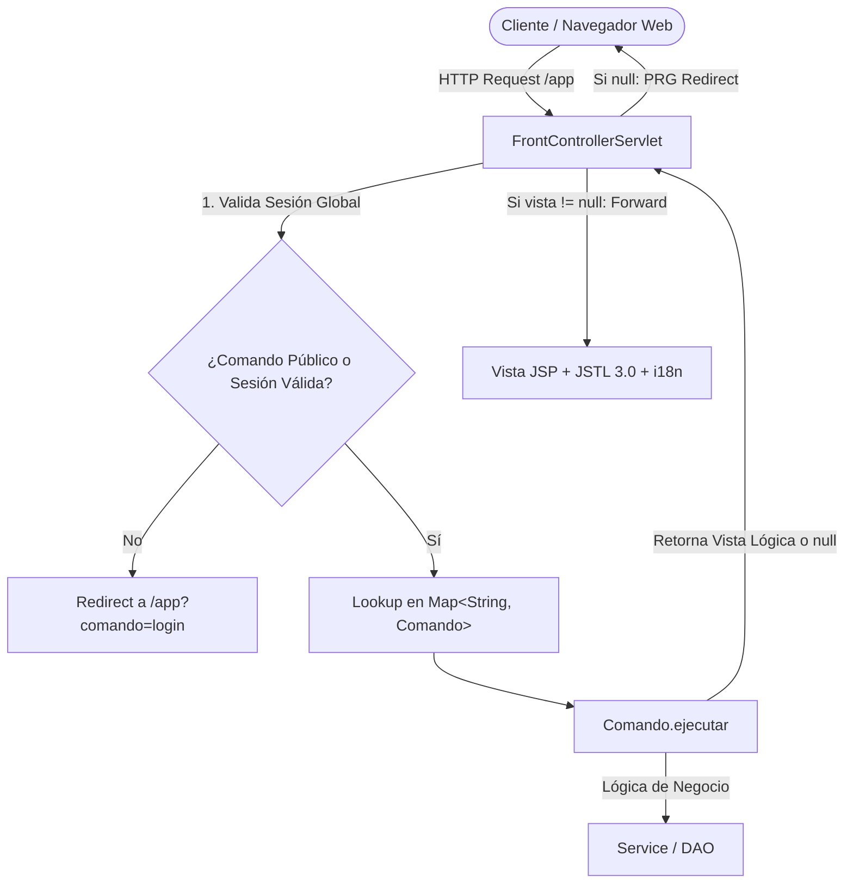

# Post-contenido — Unidad 6: JSP con MVC
## Gestor de Tareas MVC con Front Controller, Sesiones, Roles e i18n

**Autor:** Reyes  
**Tecnologías:** Java 17, Jakarta Servlet API 6.0, JSTL 3.0, Apache Tomcat 10+, Maven

---

## 1. Resumen Ejecutivo del Proyecto

El proyecto **Gestor de Tareas MVC** es una aplicación web empresarial construida bajo el estándar **Jakarta EE 10**, aplicando una arquitectura Modelo-Vista-Controlador (MVC) formal y desacoplada mediante la combinación del patrón **Front Controller** y el patrón **Comando (Command Pattern)**.

### Componentes de la Parte 1: Arquitectura Base MVC
- **Punto de Entrada Unificado:** `FrontControllerServlet` mapeado a `/app`, responsable de recibir todas las peticiones HTTP, resolver el comando correspondiente y coordinar la navegación.
- **Patrón Comando:** Interfaz `Comando` con implementaciones independientes (`ListarComando`, `FormularioComando`, `GuardarComando`, `EliminarComando`, `CompletarComando`, `LoginComando`, `LogoutComando`, `IdiomaComando`).
- **Patrón PRG (Post-Redirect-Get):** Tras operaciones de mutación (creación, edición, completado, eliminación y login), el controlador emite un `sendRedirect` hacia una petición GET (`/app?comando=listar`), evitando el reenvío duplicado de formularios al recargar el navegador.
- **Vistas JSP Limpias:** Vistas JSP (`login.jsp`, `lista.jsp`, `formulario.jsp`) con **CERO scriptlets Java (`<% ... %>`)**, utilizando exclusivamente Expression Language (EL) y las librerías de etiquetas de JSTL 3.0 (`jakarta.tags.core` y `jakarta.tags.fmt`).

### Componentes de la Parte 2: Seguridad, Validación e Internacionalización
- **Gestión Centralizada de Sesiones:** Verificación obligatoria de `usuarioActual` en `FrontControllerServlet.procesar()` para todos los comandos no públicos.
- **Control de Acceso Basado en Roles (RBAC):** Restricción de operaciones críticas como la eliminación de tareas exclusivamente para usuarios con rol `ADMIN`.
- **Validación Granular Campo por Campo:** `GuardarComando` evalúa de forma independiente título (presencia y longitud máxima leída del contexto), categoría, prioridad válida ("Alta", "Media", "Baja") y fecha límite (formato `yyyy-MM-dd` y fecha $\ge$ hoy). Despliega retroalimentación visual en formulario con clases CSS `.input-error` y `.campo-error`.
- **Internacionalización (i18n) con Cookies Persistentes:** Soporte multi-idioma (Español e Inglés) a través de `ResourceBundle` (`messages.properties` y `messages_es.properties`) y persistencia de preferencia mediante la Cookie `idiomaPreferido` con vigencia de 30 días.

---

## 2. Decisiones de Diseño de Arquitectura

A continuación se detallan las cuatro decisiones de diseño fundamentales implementadas en la solución:



### 1. El Comando devuelve la vista lógica y no hace forward
- **Fundamento:** Si cada comando ejecutara internamente `req.getRequestDispatcher(vista).forward(req, resp);`, se crearía una duplicación masiva de código y se acoplaría el comando al mecanismo de despacho del contenedor.
- **Beneficio:** Al retornar una cadena (`String`) que representa la vista lógica (ej. `"/WEB-INF/views/lista.jsp"`) o `null` si se ejecutó un `sendRedirect`, el `FrontControllerServlet` mantiene el control absoluto del ciclo de vida de la petición. Esto permite intercalar lógica transversal previa o posterior al forward (como métricas, auditoría, encabezados de seguridad o compresión).

### 2. Front Controller vs un Servlet por acción
- **Fundamento:** Crear un `HttpServlet` por cada acción (`ListarServlet`, `GuardarServlet`, `EliminarServlet`, etc.) obligaría a replicar la verificación de sesión y permisos en cada uno de ellos, o depender de múltiples filtros web difíciles de sincronizar con parámetros dinámicos.
- **Beneficio:** Al centralizar todo en el `FrontControllerServlet`, la verificación de autenticación para comandos protegidos se realiza en un único bloque de código dentro del método `procesar()`. Si un usuario sin sesión intenta ejecutar `guardar`, `eliminar`, `completar` o `listar`, el flujo se intercepta de inmediato en un único punto antes de instanciar o invocar cualquier comando.

### 3. Uso de HttpSession vs Cookies
- **Fundamento:** Se aplica el principio de menor exposición y seguridad según la sensibilidad del dato:
  * **`HttpSession`:** Empleada para el objeto `Usuario` autenticado (`usuarioActual`) y su `rol`. La información reside de manera segura en la memoria del servidor (identificada solo por un token `JSESSIONID`), expirando automáticamente tras 30 minutos de inactividad (`maxInactiveInterval = 1800`) o al ejecutar logout explícito.
  * **`Cookie`:** Empleada para la preferencia de idioma (`idiomaPreferido`). Al no ser un dato sensible de seguridad, se almacena en el navegador del cliente con una vigencia de 30 días (`maxAge = 2592000` s) y `path="/"`. Esto garantiza que cuando el usuario vuelva a abrir el navegador o antes de autenticarse en la pantalla de login, la interfaz ya se presente en su idioma elegido.

### 4. Lectura de longitud máxima del título desde el ServletContext
- **Fundamento:** Los límites de validación de negocio (como el tamaño máximo de un título) no deben estar "quemados" (*hardcoded*) en el código fuente de los comandos ni de las entidades.
- **Beneficio:** Al declararse en `web.xml` mediante `<context-param><param-name>app.maxLongitudTitulo</param-name><param-value>80</param-value></context-param>`, el parámetro se carga dinámicamente en el `ServletContext` durante `init()`. Esto permite a administradores y operadores de sistemas modificar dicha regla de negocio en tiempo de despliegue sin necesidad de recompilar el proyecto Java.

---

## 3. Estructura del Proyecto

```
gestor-tareas-mvc/
├── pom.xml
├── README.md
├── capturas/
│   ├── 01_login_idioma_espanol.jpg
│   ├── 02_listado_tareas_admin.jpg
│   └── 03_formulario_validacion_errores.jpg
└── src/
    └── main/
        ├── java/
        │   └── com/
        │       └── ejemplo/
        │           └── mvc/
        │               ├── controller/
        │               │   ├── FrontControllerServlet.java
        │               │   └── comando/
        │               │       ├── Comando.java
        │               │       ├── CompletarComando.java
        │               │       ├── EliminarComando.java
        │               │       ├── FormularioComando.java
        │               │       ├── GuardarComando.java
        │               │       ├── IdiomaComando.java
        │               │       ├── ListarComando.java
        │               │       ├── LoginComando.java
        │               │       └── LogoutComando.java
        │               ├── model/
        │               │   ├── Tarea.java
        │               │   ├── TareaDAO.java
        │               │   ├── Usuario.java
        │               │   └── UsuarioDAO.java
        │               └── service/
        │                   ├── AutenticacionService.java
        │                   └── TareaService.java
        ├── resources/
        │   ├── messages.properties
        │   └── messages_es.properties
        └── webapp/
            ├── index.jsp
            ├── css/
            │   └── estilos.css
            └── WEB-INF/
                ├── web.xml
                └── views/
                    ├── formulario.jsp
                    ├── lista.jsp
                    └── login.jsp
```

---

## 4. Cuentas de Acceso y Credenciales Preconfiguradas

| Usuario | Contraseña | Nombre Completo | Rol Asignado | Permiso de Eliminación |
| :--- | :--- | :--- | :---: | :---: |
| **admin** | `Admin123!` | Administrador General | `ADMIN` |  Permitido |
| **maria** | `Maria2026!` | María Fernanda Rojas | `USER` |  Bloqueado (Muestra alerta de seguridad) |

---

## 5. Instrucciones de Compilación y Despliegue

### Requisitos Previos
- **Java Development Kit (JDK):** Versión 17 o superior.
- **Apache Maven:** Versión 3.8+.
- **Servidor de Aplicaciones:** Apache Tomcat 10.1+ (soporte nativo para Jakarta EE 10 / Servlet 6.0).

### Compilación y Empaquetado WAR
Abra una terminal en la raíz del proyecto y ejecute:

```bash
mvn clean package
```

Este comando generará el archivo `target/gestor-tareas-mvc.war`.

### Despliegue en Apache Tomcat 10+
1. Copie el archivo `gestor-tareas-mvc.war` dentro del directorio `webapps/` de su instalación de Apache Tomcat 10+.
2. Inicie el servidor ejecutando `bin/startup.bat` (Windows) o `bin/startup.sh` (Linux/macOS).
3. Acceda desde su navegador web a:
   ```
   http://localhost:8080/gestor-tareas-mvc/
   ```
   (El archivo `index.jsp` redirigirá automáticamente a `http://localhost:8080/gestor-tareas-mvc/app`).

---

## 6. Evidencias y Capturas de Pantalla

Las capturas de pantalla de validación se encuentran alojadas en el directorio [`capturas/`](capturas/):

1. **Pantalla de Inicio de Sesión e i18n:** [`capturas/01_login_idioma_espanol.jpg`](capturas/01_login_idioma_espanol.jpg)  
   Demuestra el diseño de login con selector de idioma activo (ES/EN) y presentación visual moderna.
2. **Dashboard de Tareas (Rol ADMIN):** [`capturas/02_listado_tareas_admin.jpg`](capturas/02_listado_tareas_admin.jpg)  
   Visualización de la tabla de tareas, badges de prioridad/estado, saludo personalizado con rol y botones de acción.
3. **Validación Granular de Formulario:** [`capturas/03_formulario_validacion_errores.jpg`](capturas/03_formulario_validacion_errores.jpg)  
   Muestra el despliegue del bloque general de errores, resaltado de campos con `.input-error` y mensajes específicos con `.campo-error`.